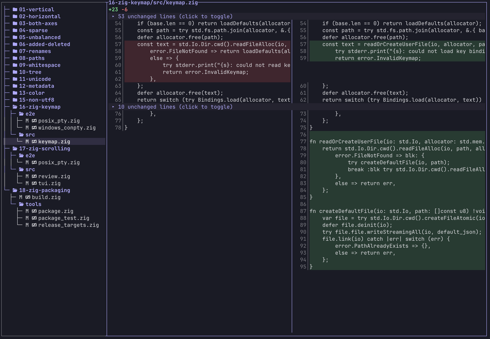
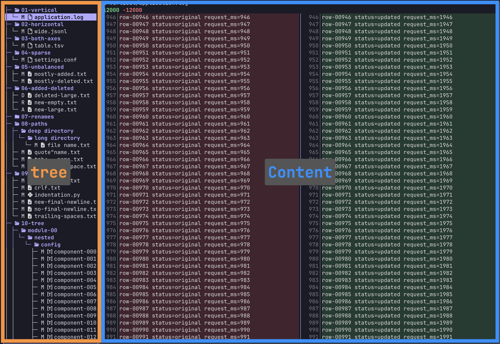
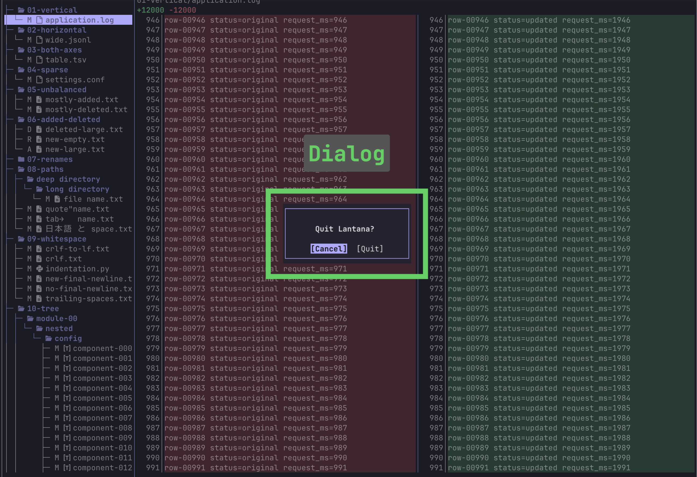

# Lantana

[](LICENSE)
[](https://github.com/hashiiiii/Lantana/releases)
[](https://github.com/hashiiiii/Lantana/actions/workflows/ci.yml)

Lantana is a terminal viewer for Git patches, with a file tree and side-by-side diffs.  
Use `lantana` or embed its Zig module.

<p align="center">
  
</p>

## Installation

### Homebrew (macOS / Linux)

```sh
brew install hashiiiii/tap/lantana
```

### Scoop (Windows)

```sh
scoop bucket add hashiiiii https://github.com/hashiiiii/scoop-bucket
scoop install lantana
```

### mise

```sh
mise use -g github:hashiiiii/Lantana
```

### Manual

Download your platform's ZIP from [GitHub Releases](https://github.com/hashiiiii/Lantana/releases).  
Extract `lantana` (`lantana.exe` on Windows) and add its directory to `PATH`.

## Usage

View staged and unstaged changes:

```sh
git diff HEAD | lantana
```

| Changes | Command |
| --- | --- |
| Unstaged | `git diff \| lantana` |
| Staged | `git diff --cached \| lantana` |

### Git integration

Set Lantana as Git's diff pager, then remove the setting with `unset`:

```sh
lantana set
git diff
lantana unset
```

| Command | Git configuration |
| --- | --- |
| `lantana set --project` | Current clone; creates `.lantana.gitconfig` |
| `lantana set --local` | Current clone |
| `lantana set --user` | Global |

`--local` is the default. Pass the same scope to `unset`.

For `--project`, commit `.lantana.gitconfig` and run `lantana set --project` once in each clone.

Select files with Up/Down, press Enter to focus the diff, and Esc to return to the tree.  
Scroll with Up/Down or `j`/`k`; press `q` to quit.

### External renderers

Lantana displays external command output in the content pane. Press `m` to switch between this view and the raw diff.
If no rule matches, source contents are unavailable, or rendering fails, Lantana shows the raw diff.

The first time you view a diff, Lantana creates `renderers.json` containing `[]` beside [`keymap.json`](#keymap).
Existing files are preserved. Edit `renderers.json`, then restart Lantana to apply changes.

#### Example: PrefabLens

Install [PrefabLens](https://github.com/hashiiiii/PrefabLens#installation) and put this in `renderers.json`:

```json
[
  {
    "patterns": ["*.prefab", "*.unity", "*.asset", "*.mat", "*.controller", "*.anim"],
    "command": ["prefablens", "--color", "--project", "{repo}", "{before}", "{after}"]
  }
]
```

Run `lantana set`, then `git diff` in the repository. Matching UnityYAML files show their semantic diff.
For a Unity project nested inside a repository, replace `{repo}` after `--project` with its absolute directory.

#### Other commands

Each rule requires `patterns` and `command`. The first matching rule wins.

| Field | Value |
| --- | --- |
| `patterns` | Array of path patterns relative to the repository root. Matching is case-sensitive. `*` matches any text, including `/`; other characters are literal. |
| `command` | JSON array containing the executable and its arguments. Use an executable in `PATH` or an absolute path. |
| `timeout_ms` | Optional timeout in milliseconds, from `1` to `60000`. Defaults to `10000`. |

Commands run from the repository root without a shell. Each placeholder must be a separate argument:

| Placeholder | Value |
| --- | --- |
| `{before}` | Absolute path to a temporary file with the full contents before the change |
| `{after}` | Absolute path to a temporary file with the full contents after the change |
| `{path}` | Repository-relative changed path; new path for a rename |
| `{repo}` | Absolute repository root |

Temporary files keep the changed file's extension.
The before file is empty for added files; the after file is empty for deleted files.
Read these files and print nonempty UTF-8 text to stdout, then exit with status `0`.
Lantana supports ANSI colors, bold, dim, and underline.

### Keymap

The first time you view a diff, Lantana creates `keymap.json` with the [default bindings](src/keymap.json).  
This works with Homebrew, Scoop, mise, and manual installations. Existing files are never overwritten.

Edit the file at the path below, then restart Lantana to apply changes:

| Environment | Path |
| --- | --- |
| `XDG_CONFIG_HOME` is nonempty | `$XDG_CONFIG_HOME/lantana/keymap.json` |
| Windows | `%APPDATA%/lantana/keymap.json` |
| macOS / Linux | `$HOME/.config/lantana/keymap.json` |

#### Contexts

Place bindings in the context for their UI:

| Context | Active UI |
| --- | --- |
| `global` | Either pane, except while the dialog is open |
| `tree` | Left file tree, when focused |
| `content` | Right diff pane, when focused |
| `dialog` | Quit confirmation dialog; all other contexts are inactive |

<p align="center">
  
</p>

<p align="center">
  
</p>

See [zig-keymap](https://github.com/hashiiiii/zig-keymap#keys) for key syntax.

## Development

Install [mise](https://mise.jdx.dev/) and [activate it](https://mise.jdx.dev/cli/activate.html). Then, from the repository root:

```sh
mise install
zig build
zig build test
zig build check
```

`zig build` installs `lantana` to `zig-out/bin/`.

Applications embedding the Zig module can supply a [`DocumentRenderer`](src/root.zig).
Successful documents open by default and remain switchable to raw.

The optional PrefabLens compatibility test launches plain `git diff` with mixed UnityYAML and C# changes.
It requires an installed executable and a POSIX terminal:

```sh
zig build test-prefablens -Dprefablens=/absolute/path/to/prefablens
```

Build release archives and package files:

```sh
zig build release
```

`zig-out/release/` contains the archives; `zig-out/packages/` contains the Homebrew formula, Scoop manifest, and checksums.

Run the demo:

```sh
zig build demo
cd .zig-cache/lantana-demo
git diff HEAD | ../../zig-out/bin/lantana
```

| Directory | Contents |
| --- | --- |
| `src/` | Zig library and CLI |
| `e2e/` | Terminal and CLI tests |
| `tools/` | Git fixture, demo, and release package generators |

## Contributing

[CONTRIBUTING.md](CONTRIBUTING.md)

## License

[Apache License 2.0](LICENSE)
